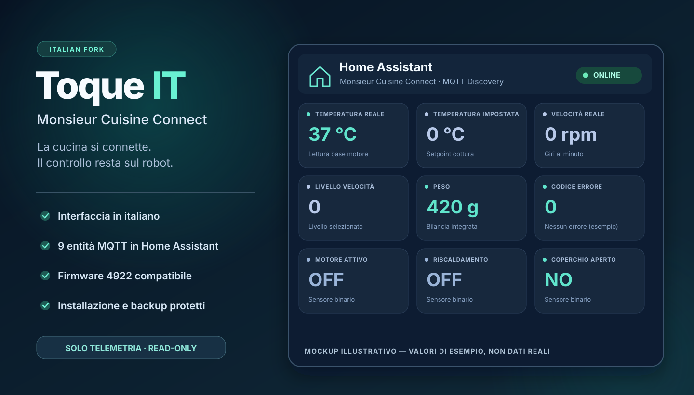

# Toque IT · Monsieur Cuisine Connect

### Il robot da cucina, in italiano. Con 9 sensori direttamente su Home Assistant.

**Fork indipendente** di [Toque di Wuki60](https://github.com/Wuki60/MrCuisineVibeConnect), pensato per **SilverCrest Monsieur Cuisine Connect SKMC 1200 · Android 6**. Le preparazioni restano gestite dal robot; Home Assistant riceve **telemetria in sola lettura**.

**Mockup illustrativo, non uno screenshot:** i valori mostrati sono esempi. Le entità reali rispecchiano la macchina e la connessione MQTT.

**[⬇ APK e release](https://github.com/samumar82/MrCuisineVibeConnect/releases/latest)** · **[Installazione rapida](README.it.md#installazione-rapida-con-backup-sicuro)** · **[Guida completa italiana](README.it.md)** · **[Originale Wuki60](https://github.com/Wuki60/MrCuisineVibeConnect)**

---

## Il vero valore aggiunto: 9 entità Home Assistant

Con MQTT Discovery il Monsieur Cuisine compare in Home Assistant come dispositivo dotato di **nove entità**, utili per dashboard, diagnostica e automazioni domestiche (per esempio, per potenziare la ventilazione durante la preparazione).

| Informazione | Tipo in HA | Esempio di entity_id |
|---|---|---|
| Temperatura reale | Sensore | <code>sensor.monsieur_cuisine_connect_temperatura_reale</code> |
| Temperatura impostata | Sensore | <code>sensor.monsieur_cuisine_connect_temperatura_impostata</code> |
| Velocità reale RPM | Sensore | <code>sensor.monsieur_cuisine_connect_velocita_reale</code> |
| Livello velocità | Sensore | <code>sensor.monsieur_cuisine_connect_livello_velocita</code> |
| Peso sulla bilancia | Sensore | <code>sensor.monsieur_cuisine_connect_peso</code> |
| Motore attivo | Sensore binario | <code>binary_sensor.monsieur_cuisine_connect_motore_attivo</code> |
| Riscaldamento attivo | Sensore binario | <code>binary_sensor.monsieur_cuisine_connect_riscaldamento_attivo</code> |
| Coperchio aperto | Sensore binario | <code>binary_sensor.monsieur_cuisine_connect_coperchio_aperto</code> |
| Codice errore scheda | Sensore | <code>sensor.monsieur_cuisine_connect_codice_errore</code> |

Gli ID sono esempi osservati su un'installazione reale; HA può assegnarne di diversi. Quando il robot è spento, le entità possono essere <strong>unavailable</strong>, normalmente.

**Nessun comando remoto di cottura.** MQTT pubblica esclusivamente stati e disponibilità. Non ci sono command topic né sottoscrizioni: nessuna automazione Home Assistant può avviare motore, riscaldamento o Turbo tramite questa integrazione. Le protezioni rimangono locali.

## Perché scegliere il fork italiano

| Funzione | Vantaggio |
|---|---|
| **Italiano integrato** | Menu, impostazioni e avvisi nella nostra lingua; disponibili anche francese e inglese |
| **MQTT + Home Assistant** | **9 entità realmente verificate**, senza compromettere il controllo locale |
| **Compatibilità firmware MCU 4922** | Correzione specifica del sensore di presenza boccale |
| **Avvio automatico** | Toque come Home all'accensione, con possibilità di tornare all'app Lidl |
| **Magisk persistente** | Root autorizzato dopo spegnimento/riaccensione, senza popup ripetuti |
| **Upgrade con backup** | Salva vecchia APK, impostazioni, ricette e preferiti prima di aggiornare |
| **Cottura upstream** | Cottura manuale e guidata, bilancia e programmi del progetto originale |

**Ricette:** l'interfaccia è in italiano, ma il testo delle ricette mantiene la lingua effettivamente offerta dalla fonte. Nessuna traduzione automatica dei parametri macchina.

## Un comando per aggiornare, con backup sicuro

Con **ADB su Windows** e un Monsieur Cuisine **già rootato con Magisk**, da fermo (motore e resistenza spenti), esegui dalla cartella della repository:

~~~powershell
powershell -NoProfile -ExecutionPolicy Bypass -File .\tools\installazione-rapida-it.ps1 -ConfermoRobotFermo
~~~

Lo script scarica solo l'ultima release di **questo fork**, verifica SHA-256, salva APK precedente e dati in un backup **cifrato con Windows DPAPI e autenticato con HMAC**, installa senza cancellare i dati e imposta il root persistente.

**Importante:** i backup DPAPI sono recuperabili solo dallo stesso utente Windows sullo stesso PC. Non sostituiscono il backup firmware iniziale; la procedura non esegue root o flash. Consultare [installazione e ripristino dettagliati](README.it.md#installazione-rapida-con-backup-sicuro) e, per un robot non rootato, la [guida prudente al primo impianto](docs/INSTALLAZIONE-IT-SICURA.md). Non usare questa procedura mentre la macchina cucina.

### Hai già Toque IT 0.5.1 e funziona?

**Non devi aggiornare obbligatoriamente.** Le 9 entità MQTT, l'italiano e la correzione firmware 4922 funzionano già nella 0.5.1. La **0.5.2** modifica soprattutto il canale aggiornamenti interno (che ora punta al fork), la versione dell'APK e la documentazione/strumenti di installazione. **Nessuna modifica al controllo cottura o alla pubblicazione MQTT.**

**[Scarica la 0.5.2](https://github.com/samumar82/MrCuisineVibeConnect/releases/tag/v0.5.2)** · **[Differenze rispetto a Wuki60](README.it.md#differenze-dalloriginale)**

## Verifiche reali e limiti

Su un singolo SKMC 1200 Android 6 / MCU 4922 sono stati verificati: installazione e avvio HOME, root permanente dopo cold boot, collegamento della scheda motore, rilevamento boccale inserito/rimosso, lettura della temperatura con acqua tiepida e **9 entità MQTT visibili in HA**.

Il codice mantiene le funzioni upstream di cottura e supera i test automatici. **Non è certificato un collaudo completo a caldo né il comportamento degli interblocchi dinamici sotto carico sulla nuova versione.** Non bypassare mai coperchio o altri dispositivi di sicurezza. Uso a proprio rischio: progetto non affiliato a Lidl, SilverCrest o Hoyer.

## Per sviluppatori

~~~bash
./gradlew --no-daemon :core:test :app:assembleDebug
~~~

La CI verifica Kotlin, traduzioni, script, APK Android e test di protezione backup su Windows. L'APK firmata e il checksum sono pubblicati nelle [release](https://github.com/samumar82/MrCuisineVibeConnect/releases). La chiave di firma è pubblica per compatibilità e non garantisce l'identità dello sviluppatore.

**Crediti:** [Wuki60/MrCuisineVibeConnect](https://github.com/Wuki60/MrCuisineVibeConnect) (progetto originale e funzionalità di cottura), [Monsieur Cuisine Developer SDK](https://github.com/antrea/monsieur-cuisine-developer-sdk) (protocollo), [licenza MIT](LICENSE). Nessuna ricetta ufficiale né immagine Lidl viene redistribuita.

**English:** Italian fork with 9 read-only Home Assistant MQTT Discovery entities, MCU 4922 bowl-sensor support, persistent Magisk root and a backup-first upgrade tool. Recipes are not necessarily translated. Original cooking UI and features by Wuki60. [En français](README.fr.md).
